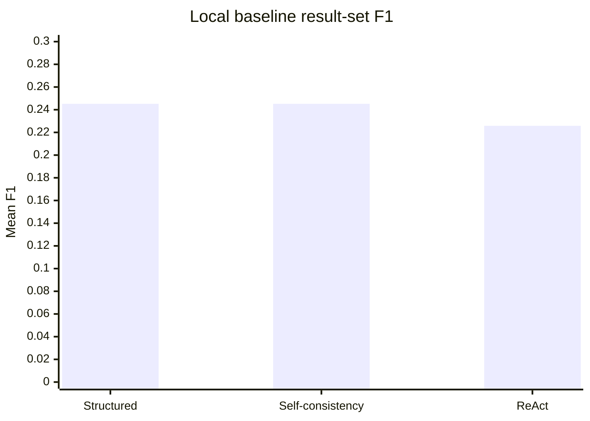

# Task 4: Detailed Prompt Comparison

## Scope and factors

The measured run uses 155 paired questions, one local-rule-based run per prompt condition, and the same database and evaluator for all conditions. The prompt condition is the manipulated factor. The model factor is held at `local-rule-based-baseline`; the coding-agent factor is held constant because the same runner and interpreter produced every condition. Consequently, this experiment isolates pipeline and strategy behavior, not the causal effect of a hosted model or coding agent.

## Results

| Prompt                          | Exact accuracy | Mean F1 | Median F1 | Mean latency (ms) |
| ------------------------------- | -------------: | ------: | --------: | ----------------: |
| Chain-of-thought structured SQL |         24.52% |  0.2452 |    0.0000 |             26.87 |
| Self-consistency SQL            |         24.52% |  0.2452 |    0.0000 |             25.67 |
| ReAct SQL                       |         22.58% |  0.2258 |    0.0000 |             12.41 |

## Statistical test

The analysis uses a paired sign-permutation test on per-question F1 differences with 10,000 deterministic permutations. The null hypothesis is that swapping the prompt labels within each question does not change the score.

| Comparison                     | Mean F1 difference | p-value | Significant at 0.05 |
| ------------------------------ | -----------------: | ------: | ------------------- |
| Structured vs ReAct            |             0.0194 |  0.1279 | No                  |
| Structured vs Self-consistency |             0.0000 |  1.0000 | No                  |
| ReAct vs Self-consistency      |            -0.0194 |  0.1279 | No                  |

No comparison is statistically significant at the selected threshold. The observed 1.94 percentage-point gap between structured and ReAct is compatible with question-level variation in this sample.

## Interpretation

Structured SQL and self-consistency tie because the local baseline does not perform model sampling or independent reasoning. ReAct is faster because it rejects questions without a grounded city or region, but that conservatism also reduces recall. The median F1 of zero for every condition shows that performance is concentrated in a minority of questions; this is why aggregate exact accuracy alone should be treated cautiously.

For the intended hosted-model study, repeat each condition with the same model, temperature, and schema, record the real model identifier and token usage, and use fresh sessions as Task 2 requests. Then rerun `analyze_results.py`. The model and coding-agent factors should be varied in a factorial design only after the single-model comparison is stable.
