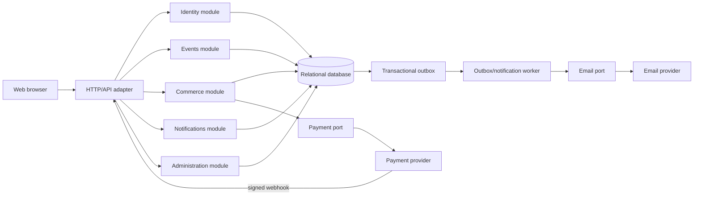
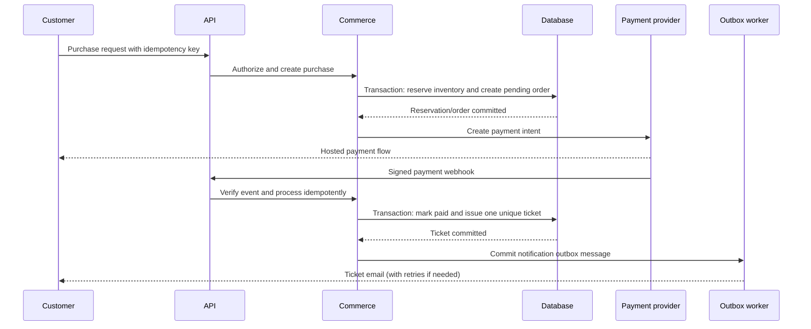

# ADR-001: Use a Modular Monolith with Hexagonal Boundaries

- **Status:** Accepted
- **Date:** 2026-10-27
- **Decision owners:** Event Ticket product and engineering team
- **Scope:** Initial web application for event discovery, event management, pre-sales, ticket purchases, payments, and notifications
- **Related record:** [Task 1 conversation](../Task_1/conversation_log.txt)
- **Requirements source:** [Event Ticket requirements](../data/EventTicket.txt)

## Context

Event Ticket is a web application with public event discovery and three
authenticated roles:

- **User:** manages a profile and favourite categories, receives related-event
  notifications, books pre-sales, buys and pays for tickets, and views the
  resulting records.
- **Manager:** creates events and views events proposed by that manager.
- **Admin:** adds managers and manages an administrator profile.

Unauthenticated clients can browse, register, log in, log out, and recover a
forgotten password. The system must protect personal data, enforce role and
ownership authorization, manage finite ticket/pre-sale inventory, confirm
online payments, issue ticket codes, and send notifications.

The highest-risk workflow is a concurrent purchase:

1. A customer submits a purchase.
2. Inventory is reserved without overselling.
3. An order and pending payment are recorded.
4. Payment is confirmed by a trusted provider callback or provider-side lookup.
5. Exactly one ticket is issued.
6. The customer can retrieve the ticket even if email delivery is delayed.

The requirements do not establish a scale that justifies distributed services,
nor do they require a particular payment or email provider. The architecture
must therefore preserve transactional correctness while keeping external
providers replaceable.

## Decision drivers

1. Keep inventory, order, payment state, and ticket issuance consistent.
2. Make authorization explicit for user, manager, and admin capabilities.
3. Prevent duplicate processing of client requests and payment callbacks.
4. Keep email and payment integrations replaceable and testable.
5. Support reliable retries without sending duplicate tickets or emails.
6. Keep initial deployment and local development practical for a small team.
7. Preserve a credible route to extract a module if measured scale requires it.

## Decision

Use a **modular monolith with hexagonal (ports-and-adapters) boundaries**.
Deploy one application and one relational database initially, but organize the
code around business modules with explicit interfaces:

- **Identity:** registration, authentication, sessions, roles, and password
  reset.
- **Events:** categories, event details, publication, capacity, and manager
  ownership.
- **Commerce:** pre-sale reservations, inventory, orders, payments, and
  tickets. This module owns the authoritative ticket inventory.
- **Notifications:** favourite-category preferences, notification jobs,
  templates, delivery attempts, and retry status.
- **Administration:** admin-only manager creation and administrative queries.

The modules communicate through typed application services and domain events.
They do not access each other's repositories directly. Infrastructure concerns
are ports implemented by adapters, including:

- relational persistence and transaction handling;
- payment gateway calls and verified webhooks;
- email delivery;
- clock and secure identifier generation;
- background job/outbox processing.

The relational database is the initial consistency boundary. The outbox is
written in the same transaction as the domain change and is processed
asynchronously by a worker.

## Architecture overview

The diagram is a logical view. It does not prescribe a framework, database
vendor, payment provider, or email vendor.

### Purchase and payment flow

The browser success redirect is not proof of payment. A webhook is accepted
only after signature verification and provider-event deduplication.

## Alternatives considered

| Option | Strengths | Main costs | Decision |
|---|---|---|---|
| Layered monolith | Fastest initial delivery; simple deployment; one transaction boundary | Shared layers can become coupled; provider and business logic can leak together; future extraction is harder | Rejected |
| Modular monolith with hexagonal boundaries | Strong local consistency; explicit business boundaries; replaceable adapters; moderate operations; extraction path | More interfaces, module discipline, outbox processing, and testing effort | **Selected** |
| Microservices with event-driven integration | Independent scaling and deployment; service-level isolation; natural asynchronous integrations | Sagas, eventual consistency, duplicate/out-of-order events, service security, tracing, deployment and data-reconciliation overhead | Rejected for initial scope |

Microservices may become appropriate later, but the stated requirements alone
do not justify paying their distributed-systems cost.

## Consequences

### Positive consequences

- Inventory, order, payment, and ticket issuance can be protected by one
  relational transaction boundary.
- A payment provider or email provider can be replaced behind an adapter.
- Module-level tests can use fake ports and deterministic clocks.
- One deployment simplifies local development, incident response, and backups.
- Explicit module contracts make future extraction safer than an undifferentiated
  monolith.
- Notification failures do not undo a successful purchase because delivery is
  asynchronous and retried.

### Negative consequences

- All modules share an operational scaling unit initially.
- Internal module boundaries require code review and discipline because a
  shared database can tempt direct cross-module access.
- Notification delivery is eventually consistent: an event or ticket may be
  visible before an email is delivered.
- The outbox worker needs claiming, retry, backoff, dead-letter/manual-retry,
  and monitoring behavior.
- A modular monolith has more structure and ceremony than a basic layered
  prototype.

### Risks and mitigations

| Risk | Mitigation |
|---|---|
| Two customers buy the final ticket concurrently | Atomic conditional inventory update or locked inventory row inside a transaction; concurrency integration test |
| A payment webhook is duplicated or replayed | Verify signature; store unique provider event ID; make state transition idempotent |
| A client submits the same purchase repeatedly | Require an idempotency key and enforce uniqueness for the relevant order operation |
| Email provider is unavailable | Transactional outbox, bounded retries, dead-letter state, and manual retry |
| Manager reads or edits another manager's event | Server-side role and ownership policies on every read and mutation |
| Password reset token is exposed | Generate a random token, store only its hash, expire it, and invalidate after one use |
| Ticket code is guessed or duplicated | Cryptographically secure generation plus a database uniqueness constraint |
| Sensitive information leaks into logs | Structured logging with redaction; never log passwords, reset tokens, payment credentials, or full provider secrets |

## Invariants and implementation rules

1. Commerce is the sole authority for ticket inventory.
2. Inventory is changed only in a transaction that also records the reservation
   or order state.
3. A paid order can issue at most one ticket for the purchased entitlement.
4. Payment completion is accepted only from a verified provider webhook or a
   trusted provider-side lookup.
5. Provider events, order operations, ticket codes, and applicable user emails
   have unique identifiers/constraints.
6. Every role and ownership decision is enforced on the server, not trusted
   from client-supplied role fields.
7. Passwords are slow-hashed; reset tokens are random, hashed at rest,
   short-lived, and single-use.
8. Email delivery is not performed as a blocking part of the purchase
   transaction.
9. Timestamps are stored in UTC and converted only for presentation.
10. Payment and identity credentials are deployment secrets, never source
    files or user-visible configuration.

## Validation plan

- Unit-test authorization policies, state transitions, reservation expiry,
  ticket-code generation, and webhook idempotency.
- Integration-test migrations, foreign keys, unique constraints, conditional
  inventory updates, row locking, and outbox claiming.
- Test payment and email adapters with provider sandboxes or fakes that model
  retries, timeouts, duplicate callbacks, and failures.
- End-to-end test registration, login/logout, password reset, browsing,
  manager creation, event submission, booking, payment, ticket display, and
  notifications for each role.
- Run a concurrent purchase test against the final available inventory and
  prove that no more tickets are issued than the available quantity.
- Monitor failed payments, stuck outbox messages, expired reservations, and
  notification retry/dead-letter counts.

## Scope and non-goals

This ADR decides the initial application structure and consistency boundaries.
It does not select:

- a programming language or web framework;
- a specific relational database vendor;
- a payment or email provider;
- a mobile application architecture;
- an analytics/data-warehouse architecture;
- a deployment platform or exact infrastructure topology.

Those choices should respect the ports, invariants, and boundaries established
here.

## Evolution and reconsideration triggers

Reconsider extracting a module into a service only when evidence shows a
specific need, such as:

- sustained catalogue/search load that cannot be isolated with caching,
  indexes, read models, or worker scaling;
- independent team ownership with a stable module contract;
- a provider or compliance boundary requiring separate deployment/data access;
- notification or reporting workloads that materially affect checkout
  availability;
- a measured availability or deployment requirement that one deployable
  cannot satisfy.

Before extraction, establish versioned contracts, correlation IDs, idempotent
consumers, reconciliation procedures, and an explicit owner for each piece of
data. Do not extract services solely because microservices are fashionable.
